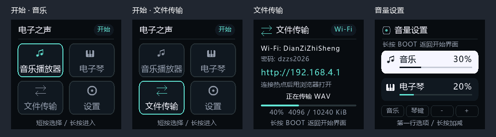
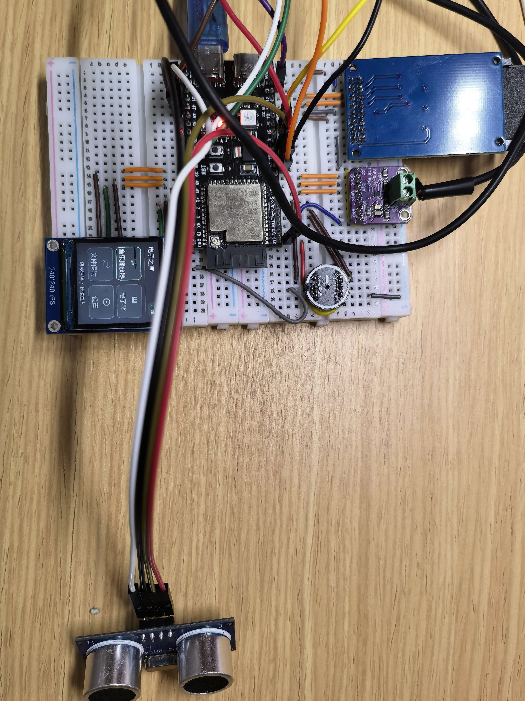
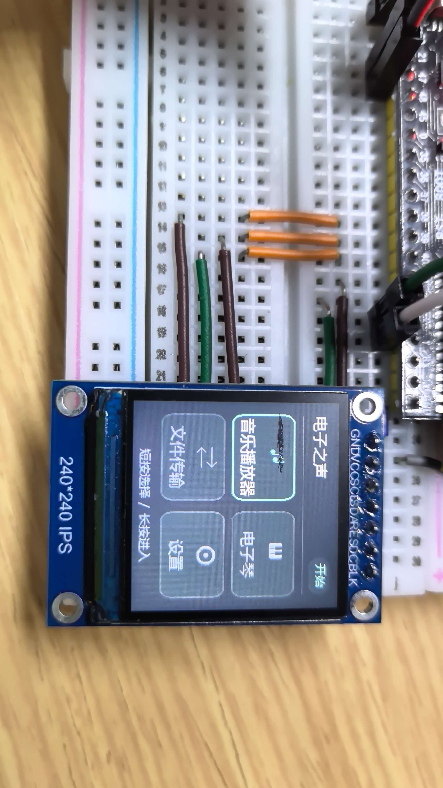
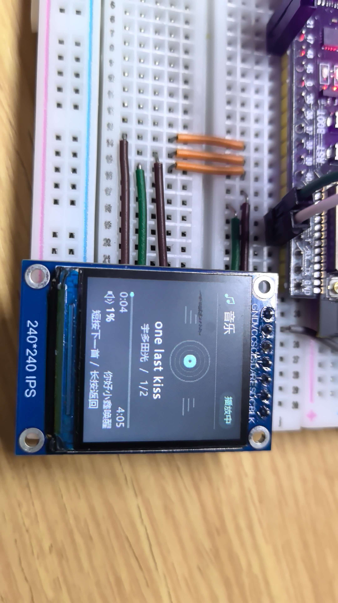

# 电子之声 · ESP32-S3 语音播放器与电子琴

**用离线中文语音控制音乐，用 4×4 键盘弹奏旋律。**

电子之声（DianZiZhiSheng）是一项基于 ESP32-S3 N16R8 的嵌入式音频项目：将 microSD WAV 播放、离线语音识别、矩阵键盘电子琴、中文彩屏和 RGB 灯效集成在同一套固件中。适合对 ESP32 音频、语音交互和多外设协作感兴趣的开发者阅读与复现。

ESP32-S3 audio project with offline Chinese voice control, WAV playback, a matrix-keypad piano, an ST7789 display and local Wi-Fi file transfer.

## 实物与界面

### 界面预览



上图为界面预览，展示四宫格选择、文件传输与音量设置；图中的百分比、传输进度等为预览示例。

### 原型实拍

<p align="center">
  <a href="assets/photos/prototype-overview.jpg"></a>
</p>

面包板原型整体搭建与外接超声波模块。以下两张原始实拍分别展示四宫格主菜单和音乐播放界面，点击可查看原图。

| 四宫格主菜单实拍 | 音乐播放界面实拍 |
| --- | --- |
| <a href="assets/photos/home-menu.jpg"></a> | <a href="assets/photos/music-player.jpg"></a> |

照片展示拍摄时的硬件与界面状态；最新固件的功能验收范围仍以[验证记录](#验证记录)和[待完成与实机验收](#待完成与实机验收)为准。

## 项目亮点

| 功能 | 可以做什么 |
| --- | --- |
| 离线中文语音 | 用“你好小鑫”唤醒，再控制播放、暂停、切歌和音量；语音识别无需云端服务 |
| WAV 音乐播放 | 从 microSD 读取音乐，显示中文歌名、作者及播放进度 |
| 矩阵键盘电子琴 | 4×4 实体按键弹奏单音，音名对应不同 RGB 灯色 |
| 手机传歌 | 连接设备热点，通过浏览器上传、下载 WAV 文件 |
| 超声波交互 | 遮挡一次切换播放/暂停，持续遮挡只触发一次 |
| 彩屏交互 | 240×240 ST7789 四宫格入口、音量设置及南邮校徽开屏动画 |

> **开发状态：持续开发中。** 最新同步版本已通过编译、语音产物检查和多项主机验证，部分功能仍待开发板实机验收。历史实机记录见[验证记录](#验证记录)，请勿将主机验证视为全部功能已实测。当前支持 WAV，尚未集成 MP3 解码。

## 从这里开始

- **准备复现**：先看[硬件连接](#硬件连接)，再看[构建与烧录](#构建与烧录d-盘嵌入式环境2026-10-21)。当前构建说明包含作者本机 D 盘路径，其他环境需要按实际安装位置调整。
- **了解交互**：[播放和语音](#播放和语音) · [按键与灯效](#按键与灯效) · [Wi-Fi 传歌](#wi-fi-wav-文件传输2026-10-19)。
- **查看进展**：[更新日志](CHANGELOG.md) · [待完成与实机验收](#待完成与实机验收)。
- **交流反馈**：欢迎在 [Issues](https://github.com/Chillchill-PLP/dianzizhisheng_project/issues) 提交复现问题、实机测试结果或功能建议。请尽量附上硬件配置、固件提交版本、复现步骤及相关日志。

技术基础：**ESP-IDF 5.5.5 · ESP-SR 2.5.5 · ESP32-S3 N16R8**。

## 当前进度（2026-10-21）

当前代码已完成完整编译、语音产物检查和多项主机验证；本次同步的版本尚待开发板实机验收。历史实机记录与本次验证分别列在下方及 [更新日志](CHANGELOG.md) 中。

- **四宫格开始页与设置**：启动动画结束后进入音乐、电子琴、文件传输、设置四个入口；BOOT 短按选择、长按进入或返回，音量设置支持长按连续调整。
- **Wi-Fi WAV 传输**：通过本地热点或可选路由器连接上传、下载 SD 卡 WAV；默认单文件上限 256 MiB，4 KiB 分块写入，包含格式校验、同名保护、取消清理及 149 MiB 文件主机测试。
- **超声波手势**：HC-SR04+ 使用 GPIO3/47；音乐模式下每次遮挡切换一次播放/暂停，移开后重新允许触发，持续遮挡不会连续切换。
- **离线语音**：唤醒词为“你好小鑫”；“播放”替代“继续”，增加“播放音乐”“恢复播放”，并针对暂停后的短词恢复识别调整置信度、静音等待和诊断日志。
- **界面与开屏**：音乐页显示中文歌名、作者和真实播放进度；ST7789 使用 40 MHz SPI、双 DMA 缓冲和变化区域刷新，运行界面局部更新上限约 59 次/秒。开屏重新采样为 107 帧、约 30 fps 的素材时间轴，慢速时跳帧；帧率和连线稳定性仍需实测。
- **RGB 与恢复**：音乐播放时彩色呼吸，电子琴按键对应音名灯色；电子琴返回播放器时自动检查、恢复 SD 挂载。
- **开发环境**：新增 D 盘独立 VS Code 入口及编译、完整烧录、串口采集、USB JTAG 任务，复用 ESP-IDF 5.5.5、ESP-SR 2.5.5 与现有 ESP 工具。
- **容量与后续工作**：应用镜像 3,120,688 字节，3 MiB 应用分区剩余 25,040 字节（约 24.5 KiB）。SG90 音乐节拍摆动尚未接入当前固件，目标范围已确定为 60°～120°，待确认信号脚和供电后继续。

## 播放和语音

将 WAV 文件放入 FAT/FAT32 格式的 microSD 卡。进入音乐播放器后按需扫描并播放，支持 PCM 8/16/24/32 位和 Float32、单/双声道、8–96 kHz。文件使用 UTF-8 长文件名打开，界面使用内置灰度字库显示中文歌名，未收录字符显示方框；无内置歌曲，也未集成 MP3 解码。

音乐模式下先说 **“你好小鑫”** 唤醒，再在 6 秒内说以下任一句。每条命令前需要重新唤醒。

| 功能 | 提示词 |
| --- | --- |
| 切歌 | 下一首、上一首 |
| 播放控制 | 暂停、播放（也可说“播放音乐”“恢复播放”） |
| 选曲 | 播放第一首、播放第二首 |
| 音量 | 增大音量、减小音量、静音、取消静音 |

“第一首/第二首”对应启动扫描时建立的播放列表顺序。电子琴模式暂停麦克风采集和语音识别，切回播放器后恢复。

音乐暂停时仍持续采集麦克风并识别唤醒词。恢复播放的操作为：先说“你好小鑫”，稍作停顿，再在 6 秒内说“播放”“播放音乐”或“恢复播放”。

针对“播放”短词，使用独立的 0.55 置信度门槛，其他命令保持 0.65；模型的候选输出门槛同步设为两者中的较小值。播放候选会等待 400 ms 的实际音频静音，再发送恢复命令，让“播放第一首/第二首”的后缀有机会先被完整识别。默认关闭 ESP-SR 在语音识别模式下提示可能降低识别率的降噪，保留 VAD 和持续输入。

串口的 `Voice candidate` 记录候选 ID、置信度和是否通过门槛；`Voice timeout` / `MultiNet timeout` 记录音频帧数、语音帧数、峰值和最后候选。恢复命令成功排队应出现 `Voice command id=4`，播放器执行后应出现 `Control=4 ... paused=0`，随后 `Control=12 ... listening=0`。这能区分未识别到命令与命令执行问题；实际声学识别率仍需在开发板上验证。

## 超声波手势切换播放/暂停（HC-SR04+）

使用支持 **3.3V 供电的 HC-SR04+ 宽电压版本**，接线如下，无需分压电阻：

| HC-SR04+ 引脚 | ESP32-S3 |
| --- | --- |
| VCC | 3V3 |
| GND | GND（所有模块共地） |
| Trig | GPIO3 |
| Echo | GPIO47 |

GPIO3 兼有 JTAG 启动配置功能，只连接模块的 Trig 输入，不要外加强上拉或接其他输出。
GPIO47/3 已核对当前工程引脚分配，未占用音频、屏幕、键盘、SD、麦克风、RGB、USB 或串口。
只有支持 3.3V 供电的版本使用此直接接线；如果改用 5V 供电，Echo 必须先转换到 3.3V。
宽电压版本说明：[HC-SR04+ 型号参数](https://protosupplies.com/product/hc-sr04-ultrasonic-range-finder-module-2/)。

- 仅音乐播放模式生效：手掌正对两个探头，距离约 **2～15 cm**，连续两次测到即切换一次播放/暂停。
- **播放中感应一下 → 暂停；暂停时再感应一下 → 从原位置播放。** 手持续停留只触发一次，移开手不改变播放状态。
- 手移到 **22 cm 以外**，或前方空旷连续三次没有有效回波后，才允许下一次感应触发。
- **15～22 cm** 之间保留遮挡状态，减少阈值附近重复触发；不要把手紧贴探头，2 cm 内属于盲区。
- 手势与语音共用播放/暂停状态：语音“暂停”后也可以感应一下播放；语音“播放”后也可以感应一下暂停。持续遮挡不会覆盖后续语音命令。
- 暂停时屏幕显示“已暂停”、进度停止、RGB 熄灭；设置中仍按当前播放模式处理，电子琴不受遮挡影响。
- 独立低优先级任务每 80 ms 测距，RMT RX 硬件计时；音频任务只读取原子状态，不等待回波。

可在 `main/main.c` 修改 `ULTRASONIC_TRIGGER_MM`、`ULTRASONIC_RELEASE_MM` 和连续确认次数；默认反应为数百毫秒，包含滤波和已有音频 DMA 缓冲时间。未连接模块时按正常播放器运行。

接线后验证：播放 WAV，将手放在约 5～10 cm 处确认暂停和进度停止；持续遮挡与移开后都应保持暂停，再遮一下应从原位置播放。再检查语音暂停后可用手势播放、语音播放后可用手势暂停，以及电子琴模式不受影响。串口应出现 `HC-SR04+ ready`、`Ultrasonic gesture: PAUSE/PLAY` 日志。

## 按键与灯效

开屏动画结束后进入 2×2 四宫格开始页，依次为音乐播放器、电子琴、文件传输、设置。短按并松开 BOOT 循环移动选中边框，长按约 1 秒进入选中的功能；进入任一功能后长按约 1 秒退出并返回开始页，选中位置保留。音乐播放模式下，短按并松开 BOOT 切换下一首，按播放列表循环，最后一首后回到第一首；暂停状态保持不变，只有一首时从头播放，无曲目时忽略。音乐页底部显示“短按下一首 / 长按返回”；长按退出不会额外触发切歌。其他功能内短按 BOOT 不切换页面。进入设置后，R1C1 选择音乐音量，R1C2 选择电子琴音量，R1C3 减小，R1C4 增大。音量范围 0–100%，步进 1%，长按加减可连续调整；重启恢复代码初始值。

| 矩阵行 | C1 | C2 | C3 | C4 |
| --- | --- | --- | --- | --- |
| R1 | C4 | D4 | E4 | F4 |
| R2 | G4 | A4 | B4 | C5 |
| R3 | D5 | E5 | F5 | G5 |
| R4 | A5 | B5 | C6 | D6 |

电子琴为单音：按住发声，松开停止；多键冲突时静音。C=红、D=橙、E=黄、F=绿、G=青、A=蓝、B=紫，同名音不同八度同色。暂停、语音监听、无歌曲、多键冲突、开始页、文件传输和设置中熄灭 RGB。

当前 `main/main.c` 的音量参数如下，修改后需重新编译烧录：

| 参数 | 当前值 | 用途 |
| --- | --- | --- |
| `PLAYER_VOLUME_PERCENT` | `1U` | 音乐上电初始音量 1% |
| `PIANO_VOLUME_PERCENT` | `1U` | 电子琴上电初始音量 1% |
| `AUDIO_OUTPUT_GAIN` | `1U` | 两种模式共用输出增益，超出 int16 时限幅 |
| `PIANO_VOLUME_DIVISOR` | `300U` | 电子琴波形的额外数字衰减 |

## Wi-Fi WAV 文件传输（2026-10-19）

1. 在开始页短按 BOOT 选中“文件传输”，长按约 1 秒进入。
2. 用手机或电脑连接热点 **DianZiZhiSheng**，密码 **dzzs2026**。热点用于本地传文件，没有互联网；手机若询问是否保留连接，请选择继续使用。
3. 浏览器打开 **http://192.168.4.1/**，选择 `.wav` 后点击上传。网页同时列出 SD 卡根目录中的 WAV，可点击下载。
4. 等待网页提示校验保存成功，再长按 BOOT 返回，进入“音乐播放器”即可播放新文件，无需重启。

传输页显示热点、密码、访问地址和实际传输进度。长按退出会取消未完成传输并清理临时文件；完整上传经过 RIFF、PCM/Float 格式、声道、采样率和数据完整性校验后才改名保存。不覆盖同名文件；不支持目录路径、MP3 或实时音频流。文件保存在 SD 卡根目录；根目录列表最多显示 64 个 WAV，原播放器最多登记 16 首，达到上限后新增文件仍保存到卡但不进入本次播放列表。默认单文件上限 256 MiB，主机验证已覆盖 149 MiB 的合法 WAV 上传。网页会在发送前检查文件大小；传输按 4 KiB 分块写入 SD，不需要把整个文件放入内存。浏览器总超时延长至 60 分钟，服务端仍保留无数据超时与退出取消处理。

Wi-Fi 仅在文件传输模式运行，进入传输前关闭播放文件并暂停语音采集；退出时等待服务器关闭文件后才恢复 SD 播放。读卡失败时显示加载/重试页，BOOT 长按仍可返回。音乐、电子琴和设置保留原有矩阵键盘、语音（仅音乐）和音量功能。

通过 `idf.py menuconfig` → **Player Wi-Fi WAV transfer** 可修改热点名称、密码、上传大小，也可填写 **Optional 2.4 GHz router SSID / Optional router password**。填写后使用 AP+STA：设备同时保留热点并连接路由器，成功后传输页和串口显示路由器分配的 IP，同一局域网内用该 IP 打开网页。路由器不可用时仍可使用设备热点。热点名称最多 32 个 UTF-8 字节，密码为 8–63 个 ASCII 字符。

新增实现为 `main/wifi_transfer.inc`，由 `main/main.c` 引入；构建增加 `esp_wifi`、`esp_event`、`esp_netif`、`esp_http_server`、`nvs_flash` 依赖。使用 ESP-IDF 原生 [HTTP Server](https://docs.espressif.com/projects/esp-idf/en/v5.5/esp32s3/api-reference/protocols/esp_http_server.html) 与 Wi-Fi 驱动。

硬件验收：检查四项短按循环、每项长按进入/退出、长按松开不重复触发；上传有效 WAV、同名文件、错误格式、传输中退出，再返回音乐确认新曲可播放；测试路由器连接/断开、无 SD 卡、空间不足和重复进入传输。此版本的主机验证与编译记录见 `tools/wifi-home-validation.md`，未代替实际开发板验收。

## 硬件连接

主控为 ESP32-S3 N16R8，16 MB Flash、8 MB 八线 PSRAM；显示驱动使用 ST7789，分辨率 240×240。矩阵键盘、SD 模块和扬声器的具体商品型号需以实物标识为准。

| 模块 | ESP32-S3 引脚 |
| --- | --- |
| MAX98357A I2S 功放 | BCLK GPIO15，LRC/WS GPIO16，DIN GPIO7 |
| ST7789 240×240 显示屏 | SCL GPIO42，SDA GPIO41，RES GPIO39，DC GPIO40，BLK GPIO38 |
| microSD 卡（SPI） | CS GPIO10，MOSI GPIO11，SCK GPIO12，MISO GPIO13 |
| INMP441 麦克风 | SCK GPIO5，WS GPIO4，SD GPIO6 |
| WS2812 RGB | DIN GPIO48 |
| HC-SR04+（3.3V 宽电压版） | VCC 3V3，Trig GPIO3，Echo GPIO47，GND 共地 |
| 矩阵键盘列 C1–C4 | GPIO9、GPIO8、GPIO2、GPIO1 |
| 矩阵键盘行 R1–R4 | GPIO14、GPIO17、GPIO21、GPIO18 |

GPIO19/20 留给 USB，GPIO0 为 BOOT，GPIO35/36/37 由八线 PSRAM 占用。MAX98357A 使用稳定的 5V 电源，所有模块共地；扬声器负端接功放 `SPK-`。

## 构建与烧录（D 盘嵌入式环境，2026-10-21）

双击本工程根目录的 **打开电子之声VSCode.cmd**，直接打开当前音乐工程。该入口使用 `D:\Embedded\vscode-data` 和 `D:\Embedded\vscode-extensions`，复用现有 ESP-IDF **5.5.5** 及 `D:\Espressif\tools` 下的 ESP 编译器、Python、OpenOCD 和 clangd。工程源码与编译输出仍位于当前工程及其 `build/`；缓存、临时文件和操作日志进入 D 盘，不修改系统全局 TEMP。

本工程是完整播放器，保留现有 16 MB Flash、8 MB Octal PSRAM、自定义分区、外设 GPIO、UART0 主控制台及 ESP-SR **2.5.5** 配置；不复制自检固件或自检工程的 sdkconfig。共享脚本每次都显式接收本工程路径，避免误操作 `esp32s3-selftest`。

通过“终端 → 运行任务”选择：

| 任务 | 用途 |
| --- | --- |
| `ESP32-S3: Build` | 编译完整播放器，再检查麦克风、语音模型、关键函数和应用容量；Ctrl+Shift+B 默认执行此任务 |
| `ESP32-S3: Flash` | 先编译和检查，再按输入的实际串口烧录 bootloader、分区表、应用和语音模型 |
| `ESP32-S3: Monitor` | 查看 115200 波特率日志；按 Ctrl+] 退出 |
| `ESP32-S3: Clean` | 清理本工程编译输出，不擦除开发板 |
| `ESP32-S3: Configure` | 重新生成当前工程的 CMake 配置 |
| `ESP32-S3: Verify speech` | 只检查已有构建产物；不能代替先编译 |
| `Serial: List ports` | 枚举串口与设备标识，不自动选择端口 |
| `Serial: Capture 10 seconds` | 采集 10 秒串口日志并退出 |
| `ESP32-S3: Debug server (native USB)` | 启动 ESP 专用 OpenOCD，要求连接原生 USB JTAG |

也可在 **PowerShell 7（pwsh）** 中执行：

```powershell
./build.ps1
# 已有有效 build 配置时保留原来的 Ninja 增量入口：
./build.ps1 -SkipConfigure
./tools/Invoke-Project.ps1 -Action Ports
# 将 COMx 替换为上一步确认的实际开发板端口：
./tools/Invoke-Project.ps1 -Action Flash -SerialPort COMx
./tools/Invoke-Project.ps1 -Action Monitor -SerialPort COMx
./tools/Invoke-Project.ps1 -Action Capture -SerialPort COMx -Seconds 10
./verify-speech-build.ps1
./backup-project.ps1
```

操作日志与原始串口采集文件按时间分别保存在 `D:\Embedded\logs\dianzizhisheng_project`。`tools/Invoke-Project.ps1` 复用 `D:\Embedded\scripts\Invoke-ESP32.ps1` 和 `serial_tool.py`；烧录、监视和采集均要求显式输入串口，不默认套用历史 COM8 或蓝牙串口。串口监视器和采集脚本通常不能同时占用同一端口。

首次或完整烧录必须包含 `build/srmodels/srmodels.bin`，任务使用 IDF 生成的完整烧录清单。应用分区为 3 MiB，模型分区为 8 MiB；已有 `sdkconfig` 时以其为准，不需要重新执行会重置配置的 `set-target`。

代码补全使用 ESP 版本 clangd 和本工程 `build/compile_commands.json`；关闭重复的 C/C++ IntelliSense，避免与 clangd 同时诊断。调试配置使用已安装 ESP-IDF 插件支持的 `gdbtarget`，明确指定本工程 ELF 及 Xtensa GDB。选择 `ESP32-S3: USB JTAG Attach (native USB required)` 可连接已烧录匹配固件的开发板，不自动烧录；只接 USB 转串口接口不能进行内置 JTAG 调试。GPIO19/20 仍预留原生 USB。

编译、语音产物检查和配置验证不等于实物功能测试；本次开发环境适配未执行烧录、串口采集或 JTAG 连接。

## 显示性能调整（2026-10-20）

本次将 `TFT_SPI_CLOCK_HZ` 从 20 MHz 提高到 40 MHz，并使用双 DMA 缓冲重叠像素准备/发送；额外占用 7680 字节内部 DMA RAM，分配失败会自动回退单缓冲。SPI 仍使用中断等待，让音频及语音任务保持更高优先级。静态画面仍不持续刷屏，有限 UI 动画可按 17 ms 最短间隔更新；开屏素材从原 SVG 重新采样为 107 帧，动态帧间隔 33/34 ms（约 30 fps），保持开头 300 ms 黑场、最终 500 ms 停留和约 4.3 秒总时长。原色表和最终校徽像素保留，慢速时按时间轴跳过过期帧。

串口 `TFT renderer` 输出 SPI 频率、实际缓冲数量和刷新间隔；`TFT refresh` 统计平均总耗时、最大耗时、绘图时间 `draw`、差分比较/打包/传输时间 `flush`、每次窗口数与像素数。请在相同页面动画、音乐播放和电子琴场景比较，不要把包含长时间静止的日志条数当作连续动画 FPS。

需要重新烧录后观察实际效果。屏幕没有读回连接，固件无法自动检测因信号质量引起的花屏；若 40 MHz 下显示异常，请将 `main/main.c` 的 `TFT_SPI_CLOCK_HZ` 改回 `(20U * 1000U * 1000U)` 并缩短接线。实际帧率和 40 MHz 连线稳定性需要开发板验证，编译和主机模拟不能替代实测。

## 动画资源

`main/njupt_splash_frames.inc` 是实际参与固件编译的 32 色 RGB565 游程压缩帧，运行时直接解码到 PSRAM 帧缓冲。备用静态校徽保留在 `main.c` 中。

`assets/njupt-splash-source.svg` 保存本次 30 fps 素材的原始矢量动画，`assets/njupt-splash-source.gif` 保留原 10 fps 黑底预览；ST7789 没有 alpha 通道，透明区域与黑底合成。安装 Pillow 后可重新生成固件资源，默认居中放大 2 倍：

```powershell
python -m pip install Pillow
# 从原 SVG 采样 30 fps（需要 Playwright 与 Edge/Chromium）：
node tools/capture_splash_frames.cjs assets/njupt-splash-source.svg splash-30fps
# 使用修改前的资源副本保留原色表和最终校徽像素：
python tools/generate_njupt_splash.py --source assets/njupt-splash-source.svg --frame-dir splash-30fps --reference-resource path/to/previous_njupt_splash_frames.inc --output main/njupt_splash_frames.inc --zoom 2
```

动画时间轴、压缩格式、错误恢复和帧率控制的详细说明见 `main.c` 中的 `tft_decode_splash_frame`、`tft_splash_wait_until` 和 `tft_play_njupt_splash`。

## 验证记录

2026-10-21 完整播放器构建及语音检查通过，模型镜像为 2,494,988 字节；实际编辑器 clangd 诊断为 0 个错误。以下记录分别说明主机验证和实机验收范围：

- [四宫格与 Wi-Fi 传输](tools/wifi-home-validation.md)
- [149 MiB 大文件上传](tools/wifi-large-upload-validation.md)
- [显示与 30 fps 开屏素材](tools/display-performance-validation.md)
- [D 盘开发环境](tools/embedded-environment-validation.md)

### 历史实机记录

2026-10-13 曾在 ESP32-S3 开发板上烧录并检查当时的 37 帧放大动画版本。串口日志记录：

```text
NJUPT splash complete: rendered=37 skipped=0, elapsed=4373 ms, max_frame=64 ms, pixels=869891
```

37 帧全部提交成功，单帧最长 64 ms，低于 100 ms 帧间隔。随后 SD 扫描成功、ESP-SR 初始化完成，并开始播放 44.1 kHz 双声道 16 位 WAV。以上是固件解码/提交耗时，不是面板扫描帧率的测量。

此前主机模拟验证覆盖了逐帧解码、变化区域传输、慢速跳帧、SPI 失败后的整屏恢复及加载页切换；硬件上还验证过电子琴返回播放器的 SD 恢复流程。长期运行、不同 SD 卡和实际语音识别率仍需继续测试。

`send_mp3.py` 为旧串口接收协议的历史工具，当前固件不实现该协议。


## 当前显示界面（Astra 风格）

界面参考 [Astra UI](https://github.com/AstraThreshold/oled-ui-astra) 的圆角列表、
反白选择器及缓动交互，以 C 独立实现并适配本工程 240×240 ST7789。
没有引入 Astra 的 C++ 框架、HAL 或开机动画；南邮校徽动画沿用现有实现。

- 音乐页显示 UTF-8 歌名、作者、曲目序号、真实已播放/总时长与进度条。
  文件名为 `作者-歌名.wav` 时分开显示；`+`/`_` 仅在画面中替换为空格。
  过长名称按完整字符省略，不改变 SD 上文件或实际读取路径。
- 电子琴页保留 4×4 实体键顺序，高亮色与 C/D/E/F/G/A/B 灯色一致。
- 音量设置使用 180 ms 滑动选择器，实际音量立即生效。
- 初始化及 SD 恢复显示“加载中”和尝试次数，不重复播放校徽动画。
- 字体包含 ASCII、GB2312 中文及界面用字；生僻字/未收录字符显示方框。
  字形使用 2-bit 灰度抗锯齿并驻留 Flash，无需 SD 字体文件。
- 动画只在显示任务中计算，原有差分刷新、优先级和物理按键操作保持不变。
  播放进度约每秒更新，暂停/监听时停止推进；无状态变化或动画时停止刷屏。

UI 源码在 `main/player_ui.inc`，字形在 `main/player_ui_fonts.inc`，
音频位置由 `main/main.c` 的播放器任务通过状态快照交给显示任务。

字体生成脚本为 `tools/generate_ui_fonts.py`，开发时使用 Python 3 + Pillow 及本机微软雅黑字体重新生成；日常构建/烧录无需运行该脚本。

## 待完成与实机验收

- 验收最新固件的手势切换、暂停后语音恢复、四宫格进出、Wi-Fi 大文件传输及 40 MHz 显示稳定性。
- 增加功能前重新评估应用分区容量；当前应用分区仅余约 24.5 KiB。
- 确认 SG90 信号 GPIO、原生 USB 使用需求和供电方案，再接入音乐模式下 60°～120° 的节拍摆动；当前固件与 RGB 灯效均未实现音乐节拍分析。
